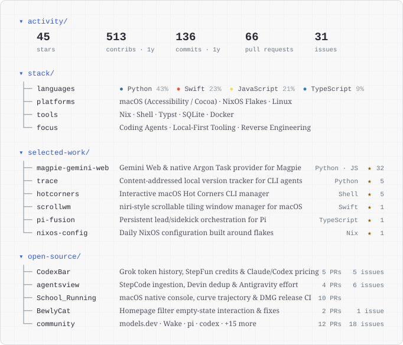

  <a href="https://bukowskiiiiii.uk/">
    <picture>
      <source media="(prefers-color-scheme: dark)" srcset="./assets/profile-dark.svg" />
      <source media="(prefers-color-scheme: light)" srcset="./assets/profile-light.svg" />
      
    </picture>
  </a>
   
  
    <code>~/links</code> ·
    <a href="https://bukowskiiiiii.uk/">bukowskiiiiii.uk</a> ·
    <a href="https://bukowskiiiiii.uk/CV/">cv/</a> ·
    <a href="https://bukowskiiiiii.uk/Blog/">blog/</a> ·
    <a href="https://bukowskiiiiii.uk/Status/">status/</a> ·
    <a href="https://bukowskiiiiii.uk/CLI/">&gt;_ cli/</a> ·
    <a href="https://x.com/zhangru81770932">x.url</a> ·
    <a href="mailto:bukaosiji@outlook.com">bukaosiji@outlook.com</a>
  

